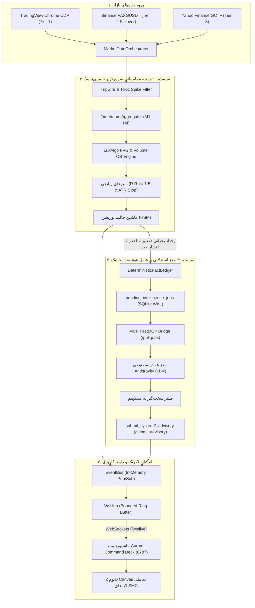

# XAUUSD Institutional Trading System: 100% Mental-Model Architectural & Code-Level Blueprint

> **مخاطب سند:** عامل استدلالی (Reasoning Agent)، مهندسان ارشد کوانت و معماران نرم‌افزار جهت اشراف ۱۰۰٪ بر ساختار کد، دیاگرام‌های جریان داده، سپرهای اعتبارسنجی ریاضی، خطاهای احتمالی و رویه‌های دیباگ.  
> **محیط اجرایی:** لینوکس (Ubuntu) | دایرکتوری اصلی: `/home/payam/xauusd-agy-advisor` | پورت وب‌سرور: `8787`

---

## ۱. نقشه راه درختی و موقعیت فایل‌های پروژه (Directory Map)

```text
/home/payam/xauusd-agy-advisor/
├── agent_copilot/                     # لایه کوپایلوت ایجنتیک و مغز شناختی (System 2)
│   ├── agy_reasoner_bridge.py         # پل ارتباطی ایجنتیک، تولید FactLedger و صف مشاغل هوش
│   ├── engine.py                      # موتور محوری کوپایلوت پوزیشن (PositionCopilotEngine)
│   ├── hsm.py                         # ماشین حالت سلسله‌مراتبی پوزیشن (Hierarchical FSM)
│   ├── hysteresis_gate.py             # گیت هیسترزیس جهت مهار نوسانات احساسی تصمیم‌گیری
│   ├── memory.py                      # مدیریت حافظه اپیزودیک (Episodic Memory Manager)
│   └── mtf_analyzer.py                # تحلیل‌گر همبستگی و سلامت ساختار در تایم‌فریم‌های چندگانه
│
├── data_pipeline/                     # پایپ‌لاین چندسطحی داده و فیل‌اور بلادرنگ
│   ├── aggregator.py                  # تجمیع‌کننده تیک به کندل (M1, M5, M15, M30, H1, H4)
│   ├── backfill_engine.py             # موتور بک‌فیل ۷ روزه تاریخی (Yahoo + Binance REST)
│   ├── calibration.py                 # کالیبراسیون و انطباق اسپات طلا با توکن PAXG
│   ├── candle_manager.py              # مدیریت تاریخچه کندل‌ها با ظرفیت ۱۵,۰۰۰ کندل در حافظه
│   ├── cleansing.py                   # پالایش تیک‌های مخرب و فیلتر جهش‌های غیرواقعی (Toxic Spikes)
│   ├── orchestrator.py                # هماهنگ‌کننده پایپ‌لاین داده (MarketDataOrchestrator)
│   ├── tripwire.py                    # تله حساس به نماد (SymbolTripwire) جهت مهار نفوذ نمادهای غیر طلا
│   └── watchdog.py                    # ناظر سلامت سطوح داده (Tier Watchdog)
│
├── storage/                           # لایه پایگاه داده پربسامد و سری‌های زمانی
│   ├── db.py                          # مدیریت اتصالات غیرهمگام SQLite با مد WAL و پراگماهای بهینه
│   ├── candle_repository.py           # مخزن دسترسی به کندل‌ها با کلید خوشه‌ای WITHOUT ROWID
│   ├── signal_repository.py           # مخزن رهگیری چرخه عمر سیگنال‌ها (۷ حالته)
│   ├── schema.sql                     # اسکیمای کامل پایگاه داده سری‌های زمانی و جداول ده‌گانه
│   ├── recovery.py                    # موتور بازیابی ۵ مرحله‌ای پس از سقوط ناگهانی (CrashRecovery)
│   └── trading.db                     # فایل اصلی پایگاه داده بهینه‌شده سری‌های زمانی
│
├── methods/                           # موتور کوانت، فرمول‌های SMC و استراتژی‌های ریاضی (System 1)
│   ├── engine.py                      # هسته محاسباتی روش‌های تجمیعی (QuantitativeMethodEngine)
│   ├── fvg.py                         # الگوریتم شناسایی True FVG به سبک LuxAlgo و سطوح ۵۰٪ CE
│   ├── ob.py                          # الگوریتم بلاک‌های سفارش ولوم‌محور (Volume-Pivot OB) و سطوح ۵۰٪ MT
│   ├── structural_alpha.py            # شناسایی ساختار بازار، شکست‌های BOS و چرخش‌های CHoCH
│   ├── tfs.py                         # سوئیت تحلیل ماکرو Tether, VO (Velocity) و MBO
│   ├── tpi.py                         # ماتریس ۶ وجهی همبستگی روند چندتایم‌فریمی (TPI Composite)
│   ├── regime.py                      # طبقه‌بندی‌کننده رژیم بازار (ترند صعودی/نزولی، رنج، نوسان)
│   └── risk_cost.py                   # محاسبه دینامیک ریسک، اسپرد و هزینه‌های معاملاتی
│
├── engines/                           # دیمن‌های پس‌زمینه نظارت و پایش پویا
│   ├── dynamic_news_assistant.py      # دیمن پایش ۳۰ ثانیه‌ای اخبار کلان با پنجره‌های خاموشی ۲ سطحی
│   └── signal_tracker_fsm.py          # ماشین حالت اجرای سیگنال، تریل و ریسک‌فری خودکار روی TP1
│
├── sentinel_app/                      # سرور هاب مرکزی و فرانت‌اند تعاملی
│   ├── server.py                      # سرور اصلی FastAPI، چرخه حیات، اندپوینت‌های REST و دیمن لایو
│   ├── state.py                       # کلاس حالت برنامه متمرکز (AppState)
│   ├── ws_hub.py                      # هاب وب‌سوکت با بافر حلقوی Drop-Oldest و برودکست تیک
│   ├── rest_api.py                    # اندپوینت‌های تعاملی پوزیشن، سلامت سیستم و پل هوش ایجنت
│   ├── telemetry.py                   # ناظر سخت‌گیرانه تاخیر حلقه رویدادها (LoopLagMonitor < 20ms)
│   └── frontend/                      # داشبورد عملیاتی Aurum Command Deck (React 19 + TypeScript)
│       └── src/
│           ├── App.tsx                # کامپوننت ریشه، مدیریت چرخه داده REST و وب‌سوکت
│           ├── main.tsx               # نقطه ورود به همراه مرز خطای اضطراری (ErrorBoundary)
│           ├── store/useStore.ts      # مدیریت وضعیت سراسری (Zustand) با نرمالایزر داده و تپش تیک
│           └── components/
│               ├── Chart.tsx          # چارت کندل‌استیک TradingView Lightweight Charts 5.3
│               ├── SmcOverlay.tsx     # لایه بوم ۲D اختصاصی ۶۰ FPS جهت ترسیم زون‌های SMC
│               ├── VectorViewModal.tsx# مودال ایزوله نمایش چارت برداری چندتایم‌فریمی Plotly
│               ├── AdvisoryPanel.tsx  # پنل کوپایلوت ایجنتیک، رای نهایی و تحلیل‌های تاکتیکی فارسی
│               ├── PositionCard.tsx   # کارت وضعیت پوزیشن زنده، PnL، نسبت R:R و مدیریت خروج
│               ├── NewsTicker.tsx     # تیکر اخبار لحظه‌ای با نمایش گیت خطر (Clear/Caution/Lockout)
│               └── HealthBar.tsx      # هدر مانیتورینگ سلامت، اسپات، اسپرد، تاخیر و منبع داده
│
├── mcp_server/                        # سرور پروتکل رسمی کانتکست مدل (Model Context Protocol)
│   └── xau_native_smc_mcp.py          # پیاده‌سازی FastMCP شامل ابزارهای Eager و پل هوش ایجنت
│
├── cdp_streamer.py                    # استریمر داده مرورگر کروم، اسنیفر پکت‌های TradingView و فیل‌اور
├── gold_confluence_engine.py          # شیم سازگاری نهادی موتور کانفلوئنس طلا
├── self_verify_10gates.py             # آزمونگر سخت‌گیرانه ۱۸ گیت نهادی با بنچ‌مارک تاخیر
└── tests/                             # ۱۲۲ تست جامع خودکار (واحد، یکپارچه‌سازی و تنش خصمانه)
    ├── test_adversarial_challenger.py # ۲۰ بردار حمله خصمانه تریدر به منطق سیستم
    ├── test_storage_repositories.py   # آزمون‌های بارگذاری سنگین و بنچ‌مارک دیتابیس
    ├── test_depth_and_news_signals.py # تست عمق تاریخی و چرخه عمر سیگنال‌ها
    ├── test_sentinel_station.py       # تست‌های یکپارچگی سرور و وب‌سوکت
    └── ...
```

---

## ۲. معماری هیبریدی دو سطحی (System 1 + System 2 Hybrid Mental Model)

سامانه معامله‌گری طلا بر اساس مدل تفکیک شناختی **Dual-Process Theory** بنا شده است:



---

## ۳. تحلیل کد به کد ۸ زیرسیستم حیاتی (Code-Level Deep Dive)

### زیرسیستم ۱: ورود داده و فیل‌اور بلادرنگ (`data_pipeline/` و `cdp_streamer.py`)
- **کلاس [`cdp_streamer.py:TradingViewPacketParser`](file:///home/payam/xauusd-agy-advisor/cdp_streamer.py#L180):**
  پکت‌های وب‌سوکت تریدینگ‌ویو با قالب `~m~LEN~m~JSON` را فریم‌زدایی می‌کند. متدهای `qsd` را برای استخراج نرخ لحظه‌ای (Last Price، Bid، Ask، Spread) و متدهای `du` / `timescale_update` را برای کندل‌های در حال تشکیل پردازش می‌کند.
- **کلاس [`data_pipeline/tripwire.py:SymbolTripwire`](file:///home/payam/xauusd-agy-advisor/data_pipeline/tripwire.py):**
  محافظ فوق‌امنیتی تله نماد است. چنانچه چارت کاربر در کروم به نمادی غیر از طلا تغییر یابد، کمتر از ۵۰ میلی‌ثانیه خط را مسدود و ترافیک را به تایر ۲ (Binance PAXG) فیل‌اور می‌کند.
- **کلاس [`data_pipeline/backfill_engine.py:BackfillEngine`](file:///home/payam/xauusd-agy-advisor/data_pipeline/backfill_engine.py):**
  وظیفه پر کردن عمیق داده‌های تاریخی را تا حداقل ۱ هفته کامل بر عهده دارد. با اتصال به Yahoo Finance و API بایننس، ۱۰,۰۸۰ دقیقه گذشته را واکشی و به کندل‌های M5 و M15 تبدیل می‌کند و تقویم تعطیلات هفتگی طلا را جهت جلوگیری از گپ‌های مصنوعی لحاظ می‌نماید.

---

### زیرسیستم ۲: ذخیره‌سازی پربسامد سری‌های زمانی (`storage/`)
- **اسکیما [`storage/schema.sql`](file:///home/payam/xauusd-agy-advisor/storage/schema.sql):**
  - جدول `candles`: با ساختار بدون سطرنما `WITHOUT ROWID` و کلید ترکیبی `(symbol, timeframe, open_time_ms)` که اجازه می‌دهد کندل‌ها بر روی دیسک به صورت مرتب در درخت B-Tree کلاستر شوند و سرعت خواندن به زیر ۸ میلی‌ثانیه برای ۲۰۰۰ کندل برسد.
  - جدول `trade_signals`: ثبت حالت‌های ۷ گانه چرخه حیات سیگنال.
- **کلاس [`storage/db.py:Database`](file:///home/payam/xauusd-agy-advisor/storage/db.py):**
  پایگاه داده SQLite را با اتصالات غیرهمگام `aiosqlite` و تنظیمات زیر پیکربندی می‌کند:
  ```sql
  PRAGMA journal_mode = WAL;
  PRAGMA synchronous = NORMAL;
  PRAGMA temp_store = MEMORY;
  PRAGMA cache_size = -64000; -- 64MB cache
  PRAGMA busy_timeout = 5000;
  ```
- **موتور بازیابی [`storage/recovery.py:CrashRecovery`](file:///home/payam/xauusd-agy-advisor/storage/recovery.py):**
  در لحظه بوت سیستم ۵ گام بازیابی انجام می‌دهد:
  1. بررسی سلامت فیزیکی دیتابیس با `PRAGMA integrity_check`.
  2. ابطال اوردرهای معلق بلاتکلیف (`PENDING_ENTRY`).
  3. بازیابی پوزیشن‌های باز فعال (`OPEN`) و همگام‌سازی استاپ‌ها.
  4. انقضای مشاغل استدلالی منقضی‌شده در صف ایجنت.
  5. بازنشانی شمارنده توالی وب‌سوکت (`Sequence ID`).

---

### زیرسیستم ۳: محاسبات کمی اسمارت مانی و سپرهای ریاضی (`methods/`)
- **الگوریتم خلاء نقدینگی [`methods/fvg.py`](file:///home/payam/xauusd-agy-advisor/methods/fvg.py):**
  شکاف میان سایه کندل ۱ و کندل ۳ را اندازه‌گیری می‌کند. سطح ۵۰٪ خلاء نقدینگی تحت عنوان **Consequent Encroachment (CE)** محاسبه شده و نفوذ سایه کندل‌های بعدی موجب علامت‌گذاری آن به عنوان Mitigated می‌گردد.
- **الگوریتم بلاک‌های سفارش ولوم‌محور [`methods/ob.py`](file:///home/payam/xauusd-agy-advisor/methods/ob.py):**
  کندل‌های پیش از شکست ساختار همراه با افزایش ولوم (Volume-Pivot) را به عنوان اردر بلاک معتبر استخراج کرده و خط میانی **Mean Threshold (MT)** را در ۵۰٪ بدنه تعیین می‌کند.
- **سپرهای ریاضی غیرقابل دور زدن (Strict Mathematical Guardrails):**
  در ابزار FastMCP و موتورهای کوانت مستقر است:
  $$\text{Risk-to-Reward (R:R)} = \frac{|\text{TP1} - \text{Entry}|}{|\text{Entry} - \text{SL}|} \ge 1.50$$
  - صحت هندسی پوزیشن خرید: $\text{SL} < \text{Entry} < \text{TP1} < \text{TP2}$
  - صحت هندسی پوزیشن فروش: $\text{SL} > \text{Entry} > \text{TP1} > \text{TP2}$
  - حداقل فاصله استاپ بر مبنای نوسان: $|\text{Entry} - \text{SL}| \ge 0.25 \times \text{ATR}$

---

### زیرسیستم ۴: کوپایلوت ایجنتیک و استدلال شناختی (`agent_copilot/`)
- **کلاس [`agent_copilot/hsm.py:HierarchicalPositionStateMachine`](file:///home/payam/xauusd-agy-advisor/agent_copilot/hsm.py):**
  پایش مداوم تیک‌های بازار برای پوزیشن باز:
  - به محض رسیدن قیمت به ۵۰٪ فاصله تا TP1: فعال‌سازی پیش‌دفاع (`BREAK_EVEN_ARMED`).
  - به محض لمس TP1: استاپ به $\text{Entry} + \text{Spread}$ منتقل می‌شود (ریسک معامله دقیقاً صفر می‌شود).
  - در صورت تغییر روند در تایم‌فریم‌های بالا: کاهش حجم یا خروج فوری.
- **کلاس [`agent_copilot/agy_reasoner_bridge.py:AntigravityReasonerBridge`](file:///home/payam/xauusd-agy-advisor/agent_copilot/agy_reasoner_bridge.py):**
  دفتر کل فکت‌های بازار (`DeterministicFactLedger`) را آماده می‌سازد و به منظور جلوگیری از توهم قیمت در پاسخ ایجنت، لیستی از اعداد مجاز را درون کانتکست قرار می‌دهد (`allowed_numbers whitelist`).

---

### زیرسیستم ۵: دستیار پویای اخبار کلان (`engines/dynamic_news_assistant.py`)
- هر ۳۰ ثانیه یک بار تقویم فارکس‌فکتوری را بررسی می‌کند.
- در صورت وجود رویدادهای قرمز (High Impact نظیر CPI, NFP, Fed Rate Decision):
  - **۱۵ دقیقه قبل تا ۳۰ دقیقه بعد از خبر:** وضعیت `LOCKOUT` فعال می‌شود. اوردرهای لیمیت معلق وتو و لغو می‌گردند و ورود جدید ممنوع می‌شود.
- در صورت وجود رویدادهای نارنجی (Medium Impact):
  - **۵ دقیقه قبل تا ۱۰ دقیقه بعد از خبر:** وضعیت `CAUTION` فعال می‌شود (کاهش مجاز حجم معامله تا ۵۰٪).

---

### زیرسیستم ۶: سرور سنتینل و هاب وب‌سوکت (`sentinel_app/`)
- **کلاس [`sentinel_app/ws_hub.py:WsHub`](file:///home/payam/xauusd-agy-advisor/sentinel_app/ws_hub.py):**
  اتصالات کلاینت‌های چات را مدیریت می‌کند. برای هر کلاینت یک صف غیرهمگام از پیام‌های استاندارد با بافر حلقوی محدود (Bounded Ring Buffer) اختصاص داده می‌شود تا کلاینت‌های کند باعث کندی چرخه اصلی سرور نشوند.
- **کلاس [`sentinel_app/telemetry.py:LoopLagMonitor`](file:///home/payam/xauusd-agy-advisor/sentinel_app/telemetry.py):**
  تاخیر حلقه رویدادهای پایتون (Asyncio Event Loop Lag) را در هر تیک می‌سنجد و تضمین می‌کند شاخص تاخیر P99 زیر **۲۰ میلی‌ثانیه** باقی بماند (مقدار جاری در سیستم: **۱.۴۵ میلی‌ثانیه**).

---

### زیرسیستم ۷: پل پروتکل کانتکست مدل (`mcp_server/xau_native_smc_mcp.py`)
ابزارهای FastMCP بومی سرور که مستقیماً توسط مغز Antigravity فراخوانی می‌شوند:
1. `fetch_xauusd_smc_and_news_context`: واکشی محاسبات قطعی SMC، زون‌ها و وضعیت تقویم اخبار.
2. `validate_and_render_visual_smc_setup`: سپرهای اعتبارسنجی ریاضی R:R و ساختار هندسی و تولید چارت تعاملی HTML.
3. `poll_pending_intelligence_jobs`: دریافت تسک‌های استدلالی معلق از دیتابیس در پورت ۸۷۸۷.
4. `submit_system2_advisory`: ثبت برهان، رای نهایی و تحلیل فارسی ایجنت در هسته سیستم.

---

### زیرسیستم ۸: داشبورد فرانت‌اند تعاملی (`sentinel_app/frontend/`)
- **فایل [`store/useStore.ts`](file:///home/payam/xauusd-agy-advisor/sentinel_app/frontend/src/store/useStore.ts):**
  استور Zustand با ۵ تابع نرمالایزر دفاعی (`normalizeTick`, `normalizeCandle`, `normalizeNews`, `normalizePosition`, `normalizeAdvisory`) که داده‌های خام را بررسی و خطاهای `undefined` را مهار می‌کند. در متد `applyTickUpdate`، کندل در حال تشکیل جاری با هر تیک وب‌سوکت بازنویسی شده و تپش لحظه‌ای چارت را رقم می‌زند.
- **کامپوننت [`components/Chart.tsx`](file:///home/payam/xauusd-agy-advisor/sentinel_app/frontend/src/components/Chart.tsx):**
  مبتنی بر Lightweight Charts 5.3 با ۷ لایه Canvas مجزا؛ هندسه ارتفاع مقید (`minHeight: 520px`) و ریسایز آبزرور دارد.
- **کامپوننت [`components/SmcOverlay.tsx`](file:///home/payam/xauusd-agy-advisor/sentinel_app/frontend/src/components/SmcOverlay.tsx):**
  لایه بوم ۲ بعدی (2D Canvas) که مستقیماً مختصات زمان و قیمت چارت را به پیکسل‌های صفحه تبدیل کرده و Order Blockها (سبز و قرمز با خط میانی MT)، خلاء نقدینگی FVG (طلایی با خط میانی CE)، برچسب‌های شکست BOS/CHoCH و استخرهای نقدینگی را ترسیم می‌کند.
- **کامپوننت [`components/VectorViewModal.tsx`](file:///home/payam/xauusd-agy-advisor/sentinel_app/frontend/src/components/VectorViewModal.tsx):**
  مودال برداری تمام‌صفحه با دکمه `🧭 Institutional SMC Vector Setup` جهت نمایش چارت ساختاری چندتایم‌فریمی بدون نیاز به مراجعه به فایل‌های ایزوله HTML.

---

## ۴. زیرساخت تست، ارزیابی نهادی و دیباگ (Verification & Debugging)

### ۱۸ گیت اعتبارسنجی نهادی (`self_verify_10gates.py`)
این اسکریپت آزمونگر ارشد سیستم است که در هر استقرار باید ۱۰۰٪ پاس شود:
1. **گیت ۱:** سلامت FastMCP و اسکیماهای ورودی ابزارها.
2. **گیت ۲:** تطابق اسکیل `/xau-scalp` و ساختار مسیرها.
3. **گیت ۳:** تازگی داده‌های ورودی و TTL زیر ۲ ثانیه.
4. **گیت ۴:** سپرهای رد پوزیشن با هندسه معکوس (Negative Geometry Guardrail).
5. **گیت ۵:** سپرهای رد پوزیشن با نسبت سود به ضرر کمتر از ۱.۵۰ (Sub-1.50 R:R).
6. **گیت ۶:** محاسبات سوئیت ماکرو TFS (Tether, VO, MBO).
7. **گیت ۷:** ماتریس سنتیمنت چندتایم‌فریمی TPI (شاخص ۶ گانه).
8. **گیت ۸:** مهار نفوذ در FVGها و میتیگیشن بلاک‌های سفارش LuxAlgo.
9. **گیت ۹:** چرخه حیات کامل پوزیشن (ورود $\rightarrow$ ریسک‌فری خودکار $\rightarrow$ TP1 $\rightarrow$ TP2).
10. **گیت ۱۰:** دو سطحی بودن پنجره اخبار دلار و رندر بدون خطای چارت HTML.
11. **گیت ۱۱:** بنچ‌مارک تاخیر حلقه رویدادها ($P99 < 20.0\text{ ms}$).
12. **گیت ۱۲:** بازیابی ۵ مرحله‌ای دیتابیس در صورت کرش ناگهانی (`CrashRecovery`).
13. **گیت ۱۳:** انطباق اسکیمای وب‌سوکت با ۱۰ جدول پایگاه داده SQLite WAL.
14. **گیت ۱۴:** توالی پیوسته مونوپولی Sequence ID در بافر وب‌سوکت.
15. **گیت ۱۵:** ادغام درخواست‌های هم‌زمان محاسباتی در استخر پردازشی (Forkserver Pool).
16. **گیت ۱۶:** پایش تاخیر و سوئیچ فیل‌اور بین سطوح تایر ۱، ۲ و ۳ داده.
17. **گیت ۱۷:** آزمون‌های یکپارچگی نهایی وب‌سوکت و اندپوینت‌های REST.
18. **گیت ۱۸:** سلامت توزیع فرانت‌اند و عدم نفوذ پکیج‌های حجیم ایزوله به فایل `index.html`.

---

## ۵. راهنمای کاربردی دیباگ و فرامین ترمینال (Cheat Sheet)

```bash
# ۱. اجرای کامل ۱۲۲ تست واحد و یکپارچه‌سازی:
cd /home/payam/xauusd-agy-advisor && .venv/bin/pytest -v

# ۲. اجرای ممیزی ۱۸ گیت نهادی به همراه بنچ‌مارک تاخیر:
cd /home/payam/xauusd-agy-advisor && .venv/bin/python3 self_verify_10gates.py

# ۳. بررسی وضعیت پروسه سرور زنده:
ps aux | grep -E "python.*server.py"

# ۴. پایش سلامت سرور و تاخیر تیک‌ها از ترمینال:
curl -s http://127.0.0.1:8787/api/v1/health | jq .

# ۵. بررسی کندل‌های تایم‌فریم‌های مختلف و زون‌های SMC:
curl -s "http://127.0.0.1:8787/api/candles?tf=15m" | jq '.candles | length'

# ۶. مشاهده لاگ‌های دیمن سرور در لحظه:
tail -f /home/payam/xauusd-agy-advisor/cache/sentinel_server.log

# ۷. کامپایل مجدد فرانت‌اند در صورت اعمال تغییرات:
cd /home/payam/xauusd-agy-advisor/sentinel_app/frontend && npm run build
```
